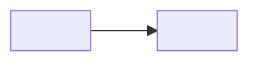

# PR description template

Replace every `<…>`. Drop a section that has nothing to say rather than filling it with filler.
Keep sentences short. A reviewer reads this before the diff.

````markdown
## Summary

<One paragraph: what this PR adds and why. If it is part of a series: "PR <k> of <n> for <epic>
(COD-<n>)", what it depends on and what it targets.>

## How it fits together

<One sentence on how the new parts connect.>



- **<Idea a reviewer must hold>.** <One or two sentences.>
- **<…>.** <…>

## Walkthrough

Each clip is <10–35> s, recorded on localhost with the dev seed as <role> (`<email>`), unless noted.

### 1. <Feature>

<Two to four lines: what happens in the clip and what to watch for. Name example data as example
data: "in the demo, Monday has two windows".>

<!-- 📎 drop 01-<feature-name>.mp4 here -->

### <n>. On a phone

<What the phone clip shows, at 390 px.>

<!-- 📎 drop <NN>-mobile-<feature-name>.mp4 here -->

## Data

<Migration name and what it adds, as a short list.>

## Authorization

- **<Surface>:** <which guard, checked against which record>.

## Decisions to confirm

- **<Decision>:** <what was chosen and why, so the reviewer can disagree>.

## Left for later

- **<Item>:** <why it waits, and for which PR or issue>.
- **Issues already on `main`,** found while testing this PR and not changed here:
  - <one line each>.

## How to test

Run `npm run db:seed` and sign in with the dev accounts in `docs-internal/DEV-ACCOUNTS.md`.

- [ ] <One step per clip, in the same order.>
- [ ] Repeat <…> at phone width.

## Checks

Typecheck, lint, Prettier and all <count> tests pass. I tested in the running app as <roles>, on
desktop (1280 px) and phone (390 px).

Closes: COD-<n>

## Checklist

- [x] Tested locally extensively
- [x] Type check passes, no leftover `console.log` or commented-out code
- [x] Checked that I do not violate any DRY principles or other best practices
- [x] No secrets or `.env` values committed
- [x] Checked on mobile and desktop viewports

🤖 Generated with [Claude Code](https://claude.com/claude-code)
````

Tick a checklist box only for what was actually done in this session.
